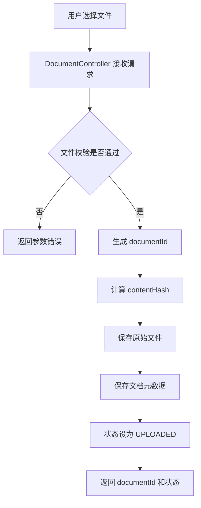
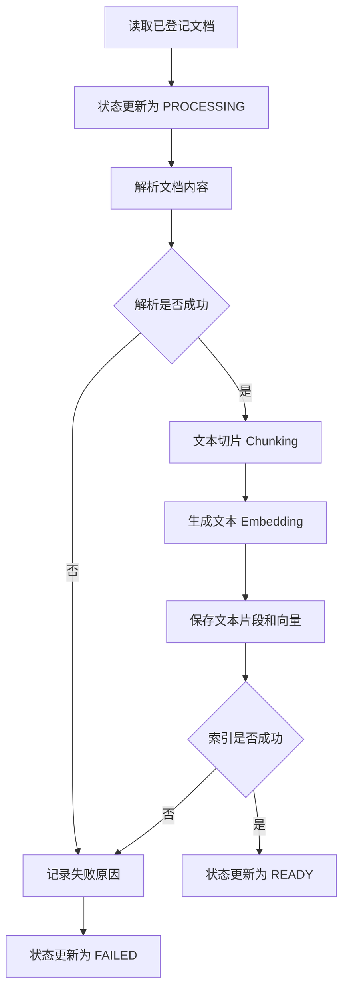
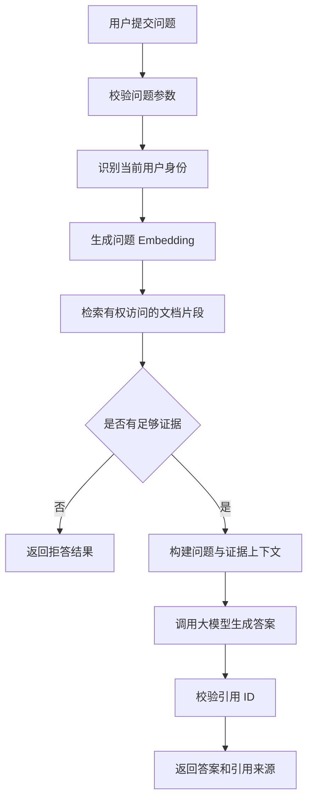

# RAG 项目核心流程图

本文档描述 RAG V1 的三个核心业务流程：文档上传、文档索引和知识库问答。

当前流程属于架构设计草图，后续将根据实际代码实现进行调整。

## 1. 文档上传流程

### 流程说明

1. 用户通过 HTTP 接口上传文件。
2. 服务端校验文件是否为空、类型是否合法以及大小是否超限。
3. 为文档生成唯一标识，并计算文件内容哈希。
4. 保存原始文件及文档元数据。
5. 将文档初始状态设置为 UPLOADED。
6. 返回文档标识和处理状态。

## 2. 文档索引流程

### 流程说明

1. 读取已登记的文档。
2. 将文档状态更新为 PROCESSING。
3. 使用对应的解析器提取文本。
4. 将长文本切分为多个 Chunk。
5. 将文本片段转换为向量。
6. 保存文本片段、必要的来源元数据及对应向量。
7. 全部处理成功后，将文档状态更新为 READY。
8. 发生处理失败时，记录错误并将状态更新为 FAILED。

说明：Embedding 和向量存储将在后续 Day 12、Day 13 实现；这里先展示预期的完整索引流程。

## 3. 知识库问答流程

### 流程说明

1. 用户提交问题，服务端校验输入。
2. 获取当前用户的身份和访问权限。
3. 将问题转换为向量，并检索相关文档片段。
4. 检索阶段必须限制在用户有权访问的文档范围内。
5. 如果没有足够证据，返回明确的拒答结果。
6. 如果证据充分，将问题和检索片段交给大模型生成答案。
7. 服务端校验引用是否来自本次检索结果。
8. 返回答案及其引用来源。

## 4. 三个流程之间的关系

文档上传负责接收和登记数据，文档索引负责将原始文档转换为可检索的数据，知识库问答负责利用检索证据回答用户问题。

只有完成索引并处于 READY 状态的文档，才应参与正常问答检索。

## 5. 后续实现对应关系

| 流程 | 对应学习阶段 |
| --- | --- |
| 文档上传 | Day 7 |
| 文档解析 | Day 8–9 |
| 文本切片 | Day 10 |
| 索引应用服务 | Day 11 |
| Embedding | Day 12 |
| 向量存储 | Day 13 |
| 语义检索 | Day 14 |
| 问答生成与引用 | Day 18–19 |
| 拒答策略 | Day 20 |
| 文档权限隔离 | Day 23 |

注意：流程图描述的是目标设计，不能据此认定上述功能已经实现。